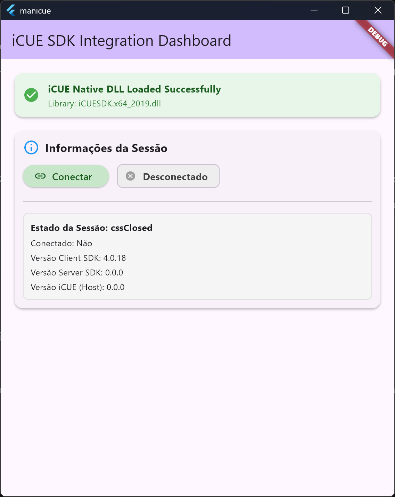
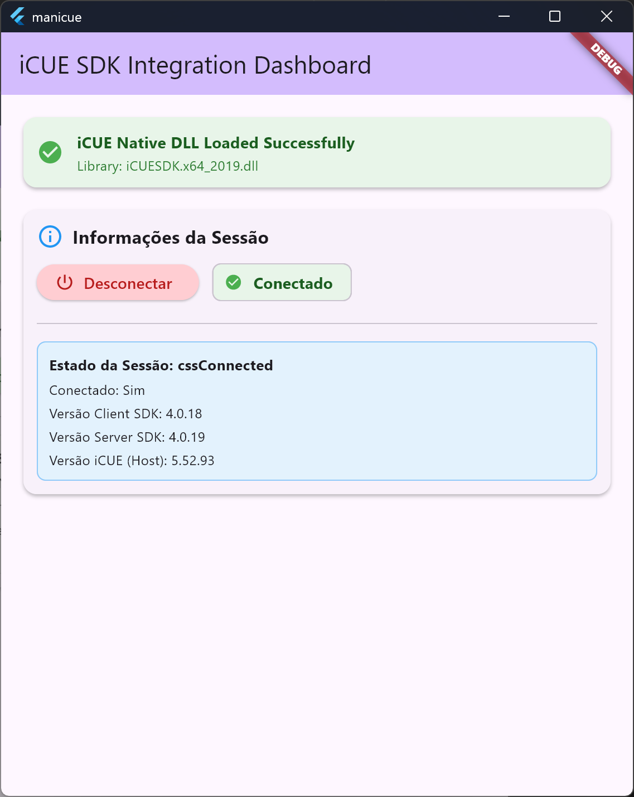
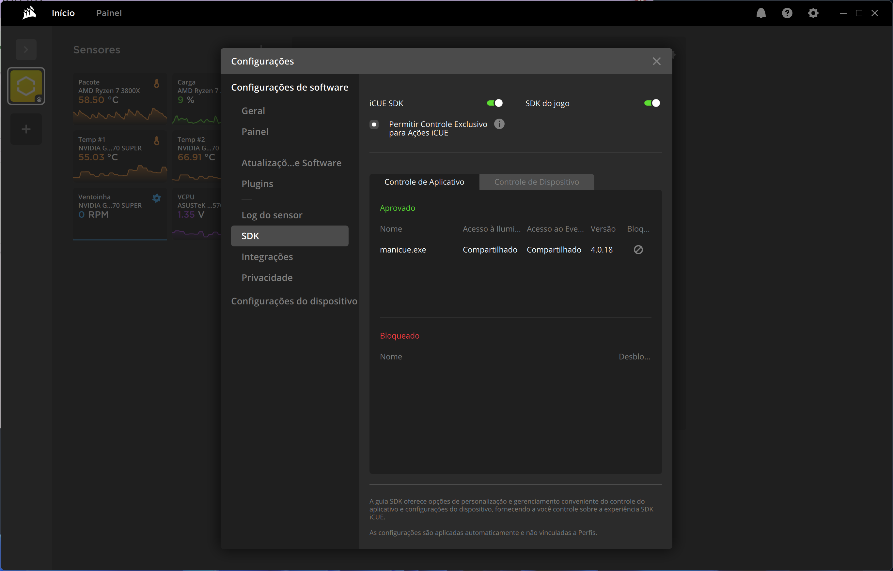

# manicue

**_manicue_** is a Flutter desktop application that connects to Corsair iCUE through its native SDK. It
provides a dashboard for checking the SDK library and iCUE session status, and a Dart FFI
integration layer for discovering devices, reading device properties, receiving events, and
controlling supported device lighting.

This project is provided as a base for other projects and is not intended to receive further
changes. The bundled iCUE SDK binary is the 64-bit Windows DLL, so the native integration is
intended for Windows x64.

## Images

 



## AI Usage Notice

AI tools have been used to assist with development and documentation in this project. AI-assisted
contributions may contain errors and should be reviewed and verified by the project maintainers. The
use of AI does not change the ownership or attribution of third-party materials included in this
repository.

## Requirements

- Flutter SDK and Dart SDK compatible with the versions specified in `pubspec.yaml`
- Windows x64
- Corsair iCUE 4.31 or later, running locally
    - Connect your usb-c cable before using on your machine
- Third-party control enabled in iCUE settings

iCUE and **_manicue_** must run with the same privilege level (both as a regular user or both as
administrator). The iCUE SDK does not work through a remote Microsoft RDP session.

## Run

Follow the [official Flutter documentation for running a project locally](https://docs.flutter.dev/get-started/test-drive?tab=terminal)
to prepare and run this project. The commands below are the project's Windows-specific run steps.

```bash
flutter pub get
flutter run -d windows
```

The dashboard reports whether the native DLL loaded and lets you connect to or disconnect from the
iCUE SDK session.

## Build

See the [official Flutter documentation for building Windows apps](https://docs.flutter.dev/platform-integration/windows/building).

```bash
flutter build windows
```

## iCUE SDK references

- [Corsair iCUE SDK on GitHub](https://github.com/CorsairOfficial/cue-sdk)
- [iCUE SDK 4.0.84 release](https://github.com/CorsairOfficial/cue-sdk/releases/tag/v4.0.84)
- [iCUE SDK API reference](docs/iocue-sdk.md)
- [Native Flutter integration notes](docs/docs.flutter.devplatform-integration.bind-native-code.md)
- [Bundled iCUE SDK headers](docs/iCUESDK_4.0.84/iCUESDK/include/iCUESDK)
- [Native integration example](docs/native_add)

The SDK communicates with hardware through iCUE. Device support and available controls depend on the
connected device and iCUE settings.

The iCUE SDK materials and binaries included in this repository are provided for convenience. Their
authorship and ownership remain with Corsair and the respective original rights holders; all credit
belongs to them. **_manicue_** does not claim ownership of these materials. For questions about the iCUE
SDK or its materials, please contact [Corsair](https://github.com/CorsairOfficial/cue-sdk).

The **_manicue_** developer is independent and is not affiliated with, endorsed by, sponsored by, or
acting on behalf of Corsair. The developer does not represent Corsair and is not responsible for
Corsair, its products, services, or SDK.

## License

Original **_manicue_** project code is licensed under the [MIT License](LICENSE). Third-party materials,
including the Corsair iCUE SDK files, remain subject to their respective owners' terms and licenses.
