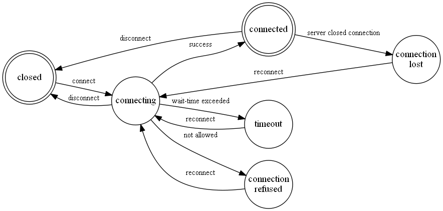

# iCUE SDK  

Overview and Reference

* * *

Protocol version 18

Table of Contents

*   [Overview](iocue-sdk.md#overview)
    *   [SDK Package](iocue-sdk.md#sdk-package)
    *   [Requirements](iocue-sdk.md#requirements)
*   [Other considerations](iocue-sdk.md#other-considerations)
    *   [LED identification](iocue-sdk.md#led-identification)
    *   [Single-color devices](iocue-sdk.md#single-color-devices)
    *   [On/off leds](iocue-sdk.md#onoff-leds)
    *   [LEDs that are not controlled by SDK](iocue-sdk.md#leds-that-are-not-controlled-by-sdk)
    *   [Transition between session states](iocue-sdk.md#transition-between-session-states)
    *   [Win+L](iocue-sdk.md#winl)
    *   [RDP limitations](iocue-sdk.md#rdp-limitations)
    *   [Access rights](iocue-sdk.md#access-rights)
*   [Reference](iocue-sdk.md#reference)
    *   [CorsairSetLedColors](iocue-sdk.md#corsairsetledcolors)
    *   [CorsairSetLedColorsBuffer](iocue-sdk.md#corsairsetledcolorsbuffer)
    *   [CorsairSetLedColorsFlushBufferAsync](iocue-sdk.md#corsairsetledcolorsflushbufferasync)
    *   [CorsairGetDevices](iocue-sdk.md#corsairgetdevices)
    *   [CorsairGetDeviceInfo](iocue-sdk.md#corsairgetdeviceinfo)
    *   [CorsairGetDevicePropertyInfo](iocue-sdk.md#corsairgetdevicepropertyinfo)
    *   [CorsairReadDeviceProperty](iocue-sdk.md#corsairreaddeviceproperty)
    *   [CorsairWriteDeviceProperty](iocue-sdk.md#corsairwritedeviceproperty)
    *   [CorsairFreeProperty](iocue-sdk.md#corsairfreeproperty)
    *   [CorsairGetLedPositions](iocue-sdk.md#corsairgetledpositions)
    *   [CorsairGetLedLuidForKeyName](iocue-sdk.md#corsairgetledluidforkeyname)
    *   [CorsairRequestControl](iocue-sdk.md#corsairrequestcontrol)
    *   [CorsairReleaseControl](iocue-sdk.md#corsairreleasecontrol)
    *   [CorsairGetLedColors](iocue-sdk.md#corsairgetledcolors)
    *   [CorsairSetLayerPriority](iocue-sdk.md#corsairsetlayerpriority)
    *   [CorsairSubscribeForEvents](iocue-sdk.md#corsairsubscribeforevents)
    *   [CorsairUnsubscribeFromEvents](iocue-sdk.md#corsairunsubscribefromevents)
    *   [CorsairConfigureKeyEvent](iocue-sdk.md#corsairconfigurekeyevent)
    *   [CorsairConnect](iocue-sdk.md#corsairconnect)
    *   [CorsairGetSessionDetails](iocue-sdk.md#corsairgetsessiondetails)
    *   [CorsairDisconnect](iocue-sdk.md#corsairdisconnect)
    *   [CorsairLedGroup](iocue-sdk.md#corsairledgroup)
    *   [CorsairLedId\_Keyboard](iocue-sdk.md#corsairledid_keyboard)
    *   [CorsairMacroKeyId](iocue-sdk.md#corsairmacrokeyid)
    *   [CorsairDeviceType](iocue-sdk.md#corsairdevicetype)
    *   [CorsairChannelDeviceType](iocue-sdk.md#corsairchanneldevicetype)
    *   [CorsairPhysicalLayout](iocue-sdk.md#corsairphysicallayout)
    *   [CorsairLogicalLayout](iocue-sdk.md#corsairlogicallayout)
    *   [CorsairSessionState](iocue-sdk.md#corsairsessionstate)
    *   [CorsairError](iocue-sdk.md#corsairerror)
    *   [CorsairAccessLevel](iocue-sdk.md#corsairaccesslevel)
    *   [CorsairEventId](iocue-sdk.md#corsaireventid)
    *   [CorsairDevicePropertyId](iocue-sdk.md#corsairdevicepropertyid)
    *   [CorsairDataType](iocue-sdk.md#corsairdatatype)
    *   [CorsairPropertyFlag](iocue-sdk.md#corsairpropertyflag)
    *   [CorsairLedColor](iocue-sdk.md#corsairledcolor)
    *   [CorsairLedPosition](iocue-sdk.md#corsairledposition)
    *   [CorsairDeviceInfo](iocue-sdk.md#corsairdeviceinfo)
    *   [CorsairDeviceFilter](iocue-sdk.md#corsairdevicefilter)
    *   [CorsairVersion](iocue-sdk.md#corsairversion)
    *   [CorsairSessionDetails](iocue-sdk.md#corsairsessiondetails)
    *   [CorsairSessionStateChanged](iocue-sdk.md#corsairsessionstatechanged)
    *   [CorsairEvent](iocue-sdk.md#corsairevent)
    *   [CorsairDeviceConnectionStatusChangedEvent](iocue-sdk.md#corsairdeviceconnectionstatuschangedevent)
    *   [CorsairKeyEvent](iocue-sdk.md#corsairkeyevent)
    *   [CorsairKeyEventConfiguration](iocue-sdk.md#corsairkeyeventconfiguration)
    *   [CorsairDataType\_BooleanArray](iocue-sdk.md#corsairdatatype_booleanarray)
    *   [CorsairDataType\_Int32Array](iocue-sdk.md#corsairdatatype_int32array)
    *   [CorsairDataType\_Float64Array](iocue-sdk.md#corsairdatatype_float64array)
    *   [CorsairDataType\_StringArray](iocue-sdk.md#corsairdatatype_stringarray)
    *   [CorsairDataValue](iocue-sdk.md#corsairdatavalue)
    *   [CorsairProperty](iocue-sdk.md#corsairproperty)

Overview
--------

The iCUE SDK gives ability for third-party applications to control lightings on Corsair RGB devices. iCUE SDK interacts with hardware through iCUE so it should be running in order for SDK to work properly.

SDK features are supported in iCUE version 4.31 or higher.

To use this SDK you should have basic knowledge in C and library linking.

### SDK Package

The following folders are included:

*   **include** contains C/C++ header files with function prototypes and enum declarations;
*   **redist** contains both 32 and 64 bit .dll files;
*   **lib** contains companion .lib files to access exported functions (32 and 64 bit);
*   **examples** contains sample project that shows how to use SDK;
*   **doc** contains SDK documentation (this document).

### Requirements

This SDK can be used on the same platforms that iCUE does:

*   **Windows 7** (32-bit and 64-bit);
*   **Windows 8** (32-bit and 64-bit);
*   **Windows 10** (32-bit and 64-bit).
*   **Windows 11** (32-bit and 64-bit).

Other considerations
--------------------

### LED identification

All supported devices have one or more LED groups. An LED can only belong to one LED group. Each LED within an LED group has its own unique identifier which in this document is defined as the CorsairLedLuid type. The CorsairLedLuid value consists of a group and an LED index/id, structured as follows.

bits 31 .. 16

bits 15 .. 0

LED GROUP

LED INDEX / ID

*   LED group - CorsairLedGroup value
*   LED index/id - either a number starting from 1, or a value of specific enumeration (e.g., CorsairLedId\_Keyboard). 0 indicates an invalid value.

**Examples:**

*   0x00000005 - group is CLG\_Keyboard (0), LED is F4 (index is 5, which is CLK\_F4 in CorsairLedId\_Keyboard)
*   0x00010001 - group is CLG\_KeyboardGKeys (1), LED is G1 key (index is 1)
*   0x00060001 - group is CLG\_Headset (6), LED is the first one on the headset (typically, left)

### Single-color devices

If a connected device only has LEDs of one color instead of all three (RGB) then when RGB color is set to such leds SDK chooses a maximum of three (RGB) values and uses it as brightness for LED.

### On/off leds

If a connected device has some LEDs that support only on/off control (as opposed to 8bit) then if supplied brightness value is >= 128 such LED will be switched on, otherwise it will be switched off.

### LEDs that are not controlled by SDK

Side LEDs on CORSAIR STRAFE keyboards cannot be controlled by SDK. These LEDs remain controlled by iCUE regardless connected SDK clients.

Some devices have a certain number of service LED indicators (for example, WinLock or Profile LEDs on keyboards) and depending on device model iCUE may, optionally or unconditionally, prohibit controlling these LEDs by SDK. If, however, despite the prohibition on controlling the service LEDs, SDK tries to set a color for them, the new color settings will be ignored for these service LEDs without an error.

### Transition between session states

Session states are represented by CorsairSessionState enumeration. SDK client starts with CSS\_Closed state. When CorsairConnect function is called, SDK sends notification that it switches to CSS\_Connecting state. From CSS\_Connecting it may end up with CSS\_Connected (if everything is ok), CSS\_Timeout (when iCUE was not found) or CSS\_ConnectionRefused (if third-party control is disabled in iCUE settings). SDK performs automatic reconnects to go from failing state back to CSS\_Connecting.



After transitioning to CSS\_Connected state SDK will notify client application about all connected devices by sending corresponding event for each device. After transitioning to CSS\_Closed or CSS\_ConnectionLost state SDK will notify client application that all devices have been disconnected by sending corresponding event for each device, also for all G/M/S keys which are in a pressed state at the time one of these states occurred SDK should notify client application that these keys have been released.

### Win+L

iCUE will preserve communication channels with SDK clients when user locks screen, so when user session is restored and set of connected devices is unchanged the client can continue using SDK as if the session was never locked.

When user locks screen SDK will perform transition to CSS\_ConnectionLost state.

When user unlocks screen SDK will perform transition to CSS\_Connected state.

### RDP limitations

Both iCUE and SDK are designed to work on a local computer and will not work if accessed remotely through Microsoft RDP.

### Access rights

In order to be able to communicate with each other, iCUE and SDK client must run with identical access rights: either with regular access or "As Administrator"

# Reference
---------

### CorsairSetLedColors

```c
CorsairError CorsairSetLedColors(
  const CorsairDeviceId deviceId,
  int size,
  const CorsairLedColor* ledColors);
```

**Description:** sets specified LEDs to some colors. The color is retained until changed by successive calls. This function does not take logical layout into account. This function executes synchronously, if you are concerned about delays consider using CorsairSetLedColorsBuffer together with CorsairSetLedColorsFlushBufferAsync.

**Input arguments:**

*   const CorsairDeviceId deviceId - null terminated Unicode string that contains unique device identifier
*   int size - number of leds in ledColors array
*   const CorsairLedColor\* ledColors - array containing colors for each LED

**Returns:** error code. CE\_Success if successful. If there is no such ledId present in currently connected hardware (missing key in physical keyboard layout) then functions completes successfully and returns CE\_Success.

**Possible errors:**

*   CE\_NotConnected, CE\_DeviceNotFound
*   CE\_InvalidArguments - if deviceId is NULL

if ledColors array contains duplicates of some led ids, then color from the last item should be applied (ie "last win" strategy).

### CorsairSetLedColorsBuffer

```c
CorsairError CorsairSetLedColorsBuffer(
  const CorsairDeviceId deviceId,
  int size,
  const CorsairLedColor* ledColors);
```

**Description:** sets specified LEDs to some colors. This function sets LEDs colors in the buffer which is written to the devices via CorsairSetLedColorsFlushBufferAsync. Typical usecase is next: CorsairSetLedColorsFlushBufferAsync is called to write LEDs colors to the device and follows after one or more calls of CorsairSetLedColorsBuffer to set the LEDs buffer. This function does not take logical layout into account.

**Input arguments:**

*   const CorsairDeviceId deviceId - null terminated Unicode string that contains unique device identifier
*   int size - number of leds in ledColors array
*   const CorsairLedColor\* ledColors - array containing colors for each LED

**Returns:** error code. CE\_Success if successful. If there is no such ledId present in currently connected hardware (missing key in physical keyboard layout) then function completes successfully and returns CE\_Success.

**Possible errors:**

*   CE\_NotConnected, CE\_DeviceNotFound
*   CE\_InvalidArguments - if deviceId is NULL

if ledColors array contains duplicates of some led ids, then color from the last item should be applied (ie "last win" strategy).

### CorsairSetLedColorsFlushBufferAsync

```c
typedef void(*CorsairAsyncCallback)(
  void *context,
  CorsairError error);

CorsairError CorsairSetLedColorsFlushBufferAsync(
  CorsairAsyncCallback callback,
  void *context);
```

**Description:** writes to the devices LEDs colors buffer which is previously filled by the CorsairSetLedColorsBuffer function. This function executes asynchronously and returns control to the caller immediately.

**Input arguments:**

*   CorsairAsyncCallback callback - callback that is called by SDK when colors are set. Can be NULL if client is not interested in result. Callback parameters:
    *   context - contains value that was supplied by user in CorsairSetLedColorsFlushBufferAsync call.
    *   error - error code. CE\_Success if the call was successful. **Possible errors:** CE\_NotConnected, CE\_NoControl
*   void\* context - arbitrary context that will be returned in callback call. Can be NULL

**Returns:** error code. CE\_Success if successful. If there is no such ledId present in currently connected hardware (missing key in physical keyboard layout, or trying to control mouse while it's disconnected) then function completes successfully and returns CE\_Success.

**Possible errors:**

*   CE\_NotConnected

### CorsairGetDevices

```c
CorsairError CorsairGetDevices(
  const CorsairDeviceFilter *filter,
  int sizeMax,
  CorsairDeviceInfo *devices,
  int *size);
```

**Description:** populates the buffer with filtered collection of devices

**Input arguments:**

*   const CorsairDeviceFilter \*filter - pointer to filter, that describes which of devices SDK should put to the devices array
*   int sizeMax - size of devices array (should typically be equal to CORSAIR\_DEVICE\_COUNT\_MAX)
*   CorsairDeviceInfo \*devices - preallocated buffer that SDK should populate after successful call with information about connected devices that satisfy search criteria specified by filter parameter.
*   int \*size - pointer to memory where SDK should store the actual number of items written to devices array. The value should always be less than or equal to sizeMax

**Returns:** error code. CE\_Success if successful. Also devices array will contain information about devices and size - number of devices in array on return.

**Possible errors:**

*   CE\_NotConnected
*   CE\_InvalidArguments - if filter is invalid or NULL, if devices array is NULL or too small

### CorsairGetDeviceInfo

```c
CorsairError CorsairGetDeviceInfo(
  const CorsairDeviceId deviceId,
  CorsairDeviceInfo *deviceInfo);
```

**Description:** gets information about device specified by deviceId

**Input arguments:**

*   const CorsairDeviceId deviceId - null terminated Unicode string that contains unique device identifier
*   CorsairDeviceInfo \*deviceInfo - preallocated buffer that SDK should populate after successful call with information about connected device

**Returns:** error code. CE\_Success if successful. Also deviceInfo will contain valid values read from the device on return.

**Possible errors:**

*   CE\_NotConnected, CE\_DeviceNotFound
*   CE\_InvalidArguments - if deviceInfo is NULL

### CorsairGetDevicePropertyInfo

```c
CorsairError CorsairGetDevicePropertyInfo(
  const CorsairDeviceId deviceId,
  CorsairDevicePropertyId propertyId,
  unsigned int index,
  CorsairDataType *dataType,
  unsigned int *flags);
```

**Description:** gets information about device property for the device specified by deviceId

**Input arguments:**

*   const CorsairDeviceId deviceId - null terminated Unicode string that contains unique device identifier
*   CorsairDevicePropertyId propertyId - device property identifier
*   unsigned int index - zero based property index; used when property has CPF\_Indexed flag set, otherwise should be 0
*   CorsairDataType \*dataType - a pointer to the variable to store the returned value of the CorsairDataType enumeration that specifies the type of property data
*   unsigned int \*flags - a pointer to the variable to store the returned flag values that describe operations that can be applied to the property. The value is formed as a bitwise "or" of CorsairPropertyFlag enum values

**Returns:** error code. CE\_Success if successful. Also dataType and flags will contain valid values read from device on return.

**Possible errors:**

*   CE\_NotConnected, CE\_DeviceNotFound
*   CE\_InvalidArguments - if deviceId is NULL, if dataType is NULL or flags is NULL
*   CE\_InvalidOperation - if property does not exist for specified device

### CorsairReadDeviceProperty

```c
CorsairError CorsairReadDeviceProperty(
  const CorsairDeviceId deviceId,
  CorsairDevicePropertyId propertyId,
  unsigned int index,
  CorsairProperty *property);
```

**Description:** gets the data of device property by device identifier, property identifier and property index

**Input arguments:**

*   const CorsairDeviceId deviceId - null terminated Unicode string that contains unique device identifier
*   CorsairDevicePropertyId propertyId - device property identifier
*   unsigned int index - zero based property index; used when property has CPF\_Indexed flag set, otherwise should be 0
*   CorsairProperty \*property - a variable to store a pointer to the property data. When SDK client is finished using CorsairProperty instance it should call CorsairFreeProperty function to free memory occupied by struct and its members

**Returns:** error code. CE\_Success if successful. Also property will contain a pointer to valid property data read from device on return.

**Possible errors:**

*   CE\_NotConnected, CE\_DeviceNotFound
*   CE\_InvalidArguments - if deviceId is NULL or property is NULL
*   CE\_InvalidOperation - if property does not exist for specified device

### CorsairWriteDeviceProperty

```c
CorsairError CorsairWriteDeviceProperty(
  const CorsairDeviceId deviceId,
  CorsairDevicePropertyId propertyId,
  unsigned int index,
  const CorsairProperty *property);
```

**Description:** sets the data of device property by device identifier, property identifier and property index. Can be called only with writable properties

**Input arguments:**

*   const CorsairDeviceId deviceId - null terminated Unicode string that contains unique device identifier
*   CorsairDevicePropertyId propertyId - device property identifier
*   unsigned int index - zero based property index; used when property has CPF\_Indexed flag set, otherwise should be 0
*   const CorsairProperty \*property - a pointer to the property data

**Returns:** error code. CE\_Success if successful.

**Possible errors:**

*   CE\_NotConnected, CE\_DeviceNotFound
*   CE\_InvalidArguments - if deviceId is NULL or property is NULL
*   CE\_InvalidOperation - if property does not exist for specified device

### CorsairFreeProperty

```c
CorsairError CorsairFreeProperty(CorsairProperty *property);
```

**Description:** frees memory occupied by CorsairProperty instance

**Input arguments:**

*   CorsairProperty \*property - a pointer to instance of CorsairProperty for which memory was allocated as a result of a call to CorsairReadDeviceProperty

**Returns:** error code. CE\_Success if successful.

**Possible errors:** - CE\_InvalidArguments - if property is NULL - CE\_InvalidOperation - if SDK failed to free memory for some reason

### CorsairGetLedPositions

```c
CorsairError CorsairGetLedPositions(
  const CorsairDeviceId deviceId,
  int sizeMax,
  CorsairLedPosition *ledPositions,
  int *size);
```

**Description:** provides a list of supported device LEDs by its id with their positions. Position could be either physical (only device-dependent) or logical (depend on device as well as iCUE settings).

**Input arguments:**

*   const CorsairDeviceId deviceId - null terminated Unicode string that contains unique device identifier
*   int sizeMax - size of ledPositions array (should typically be equal to CORSAIR\_DEVICE\_LEDCOUNT\_MAX)
*   CorsairLedPosition \*ledPositions - preallocated buffer that SDK should populate after successful call with the list of LEDs positions
*   int \*size - pointer to memory where SDK should store the actual number of items written to ledPositions array. The value should always be less than or equal to sizeMax

**Returns:** error code. CE\_Success if successful. Also ledPositions array will contain information about LEDs positions and size - number of items in this array on return.

**Possible errors:**

*   CE\_NotConnected, CE\_DeviceNotFound
*   CE\_InvalidArguments - if deviceId is NULL, if ledPositions array is NULL or too small

### CorsairGetLedLuidForKeyName

```c
CorsairError CorsairGetLedLuidForKeyName(
  const CorsairDeviceId deviceId,
  char keyName,
  CorsairLedLuid *luid);
```

**Description:** retrieves LED luid for key name taking logical layout into account. So on AZERTY keyboards if user calls CorsairGetLedLuidForKeyName(deviceId, 'A', &luid) he gets luid with CLK\_Q code. This luid can be used in CorsairSetLedColors or CorsairSetLedColorsBuffer function

**Input arguments:**

*   const CorsairDeviceId deviceId - null terminated Unicode string that contains unique device identifier
*   char keyName - key name. \['A'..'Z'\] (26 values) are valid values
*   CorsairLedLuid \*luid - pointer to memory where SDK should store proper CorsairLedLuid or CLI\_Invalid if error occurred

**Returns:** error code. CE\_Success if successful. Also ledId will contain proper CorsairLedId on return

**Possible errors:**

*   CE\_NotConnected, CE\_DeviceNotFound
*   CE\_InvalidArguments - if deviceId is NULL, if keyName is invalid

### CorsairRequestControl

```c
CorsairError CorsairRequestControl(
  const CorsairDeviceId deviceId,
  CorsairAccessLevel accessLevel);
```

**Description:** requests control using specified access level. By default client has shared control over lighting and events so there is no need to call CorsairRequestControl() unless client requires exclusive control

**Input arguments:**

*   const CorsairDeviceId deviceId - null terminated Unicode string that contains unique device identifier. Can be NULL to request control for all devices
*   CorsairAccessLevel accessLevel - requested access level

**Returns:** error code. CE\_Success if SDK received requested control

Possible errors:

*   CE\_NotConnected, CE\_DeviceNotFound, CE\_NoControl
*   CE\_InvalidArguments - if provided accessLevel is not supported by this version of SDK
*   CE\_NotAllowed - if exclusive control is disabled in iCUE settings

### CorsairReleaseControl

```c
CorsairError CorsairReleaseControl(const CorsairDeviceId deviceId);
```

**Description:** releases previously requested control for specified device. This action resets access level to default (shared)

**Input arguments:**

*   const CorsairDeviceId deviceId - null terminated Unicode string that contains unique device identifier. Can be NULL to release control for all devices

**Returns:** error code. CE\_Success if SDK released control

**Possible errors:**

*   CE\_NotConnected, CE\_DeviceNotFound
*   CE\_InvalidArguments - if deviceId is NULL

**Behavior:** when this function is called iCUE should clear all colors set by previous calls to CorsairSetLedsColors\*\` functions if client had exclusive lighting access level and devices should show lightings that come from iCUE. Client may request exclusive control again after calling CorsairReleaseControl

### CorsairGetLedColors

```c
CorsairError CorsairGetLedColors(
  const CorsairDeviceId deviceId,
  int size,
  CorsairLedColor* ledColors);
```

**Description:** get current color for the list of requested LEDs of supported device. The color should represent the actual state of the hardware LED, which could be a combination of SDK and/or iCUE input.

**Input arguments:**

*   const CorsairDeviceId deviceId - null terminated Unicode string that contains unique device identifier
*   int size - number of leds in ledColors array
*   CorsairLedColor\* ledColors - array containing colors for each LED. Caller should only fill ledId field, and then SDK will fill R, G, B and A values on return.

**Returns:** error code. CE\_Success if successful. If there is no such ledId present in currently connected hardware (missing key in physical keyboard layout, or trying to control mouse while it's disconnected) then function completes successfully and returns CE\_Success. Also ledColors array will contain R, G, B and A values of colors on return

**Possible errors:**

*   CE\_NotConnected, CE\_DeviceNotFound
*   CE\_InvalidArguments - if deviceId is NULL; if array contains duplicates of some led ids

### CorsairSetLayerPriority

```c
CorsairError CorsairSetLayerPriority(unsigned int priority);
```

**Description:** set layer priority for this shared client. By default iCUE has priority of 127 and all shared clients have priority of 128 if they don't call this function. Layers with higher priority value are shown on top of layers with lower priority.

**Input arguments:**

*   unsigned int priority - priority of a layer \[0..\`CORSAIR\_LAYER\_PRIORITY\_MAX\`\]

**Returns:** error code. CE\_Success if successful. If this function is called in exclusive mode then it will return CE\_Success

**Possible errors:**

*   CE\_NotConnected
*   CE\_InvalidArguments - if priority value is beyond \[0..255\] interval

### CorsairSubscribeForEvents

```c
typedef void(*CorsairEventHandler)(
  void *context,
  const CorsairEvent *event);

CorsairError CorsairSubscribeForEvents(
  CorsairEventHandler onEvent,
  void *context);
```

**Description:** registers a callback that will be called by SDK when some event happened. If client is already subscribed but calls this function again SDK should use only last callback registered for sending notifications

**Input arguments:**

*   CorsairEventHandler onEvent - callback that is called by SDK when some event happened. Callback parameters:
    *   context - contains value that was supplied by user in CorsairSubscribeForEvents call.
    *   event - information about event, user can distinguish between events by reading event->id field.
*   void\* context - arbitrary context that will be returned in callback call. Can be NULL

**Returns:** error code. CE\_Success if successful.

**Possible errors:**

*   CE\_NotConnected
*   CE\_InvalidArguments - if onEvent is NULL

### CorsairUnsubscribeFromEvents

```c
CorsairError CorsairUnsubscribeFromEvents();
```

**Description:** unregisters callback previously registered by CorsairSubscribeForEvents call

**Input arguments:** no

**Returns:** error code. CE\_Success if successful.

**Possible errors:**

*   CE\_NotConnected

### CorsairConfigureKeyEvent

```c
CorsairError CorsairConfigureKeyEvent(
  const CorsairDeviceId deviceId,
  const CorsairKeyEventConfiguration *config);
```

**Description:** asks iCUE to send a key event from the device specified by deviceId to an exclusive SDK client only (if config->isIntercepted == true) or to all SDK clients including active exclusive client (if config->isIntercepted == false). Effective only for SDK clients with ExclusiveKeyEventsListening or ExclusiveLightingControlAndKeyEventsListening access level (see CorsairRequestControl). This function gives possibility for a client with ExclusiveKeyEventsListening or ExclusiveLightingControlAndKeyEventsListening access level to control selected set of macro keys only and let iCUE to pass some key events to other shared clients

**Input arguments:**

*   const CorsairDeviceId deviceId - null terminated Unicode string that contains unique device identifier
*   CorsairKeyEventConfiguration\* config - key event configuration. If config->isIntercepted equals true then iCUE should pass the event to an active exclusive SDK client only. If false then iCUE should send it to all the clients.

**Returns:** error code. CE\_Success if configuration was successfully applied or it was not changed (but no error occurred).

**Possible errors:**

*   CE\_NotConnected
*   CE\_NotAllowed - if exclusive control is disabled in iCUE settings
*   CE\_NoControl - if some other client has or took over exclusive control
*   CE\_InvalidOperation - if client has insufficient access level (must have ExclusiveKeyEventsListening or ExclusiveLightingControlAndKeyEventsListening access level)
*   CE\_InvalidArguments - if deviceId or config is NULL

### CorsairConnect

```c
typedef void(*CorsairSessionStateChangedHandler)(
  void *context,
  const CorsairSessionStateChanged *eventData);

CorsairError CorsairConnect(
  CorsairSessionStateChangedHandler onStateChanged,
  void *context);
```

**Description:** sets handler for session state changes, checks versions of SDK client, server and host (iCUE) to understand which of SDK functions can be used with this version of iCUE

**Input arguments:**

CorsairSessionStateChangedHandler onStateChanged - callback that is called by SDK when session state changed. Callback parameters:

> *   context - contains value that was supplied by user in CorsairConnect call.
> *   eventData - information about new session state and client/server versions.

*   void\* context - arbitrary context that will be returned in callback call. Can be NULL

**Returns:** error code. CE\_Success if successful.

**Possible errors:**

*   CE\_InvalidArguments - if onStateChanged is NULL
*   CE\_InvalidOperation - if SDK client is already connected or is connecting

### CorsairGetSessionDetails

```c
CorsairError CorsairGetSessionDetails(
  CorsairSessionDetails* details);
```

**Description:** checks versions of SDK client, server and host (iCUE) to understand which of SDK functions can be used with this version of iCUE. If there is no active session or client is not connected to the server, then only client version will be filled

**Input arguments:**

*   CorsairSessionDetails\* details - pointer to preallocated memory where to store information about SDK and iCUE versions.

**Returns:** error code. CE\_Success if successful.

**Possible errors:**

CE\_InvalidArguments - if details is NULL

### CorsairDisconnect

```c
CorsairError CorsairDisconnect();
```

**Description:** removes handler for session state changes previously set by CorsairConnect

**Input arguments:** no

**Returns:** error code. CE\_Success if successful.

**Possible errors:**

*   CE\_NotConnected

**Behavior:** before function returns session state event will be triggered with state changed to CSS\_Closed

### CorsairLedGroup

```c
enum CorsairLedGroup
```

**Description:** contains a list of led groups. Led group is used as a part of led identifier

**Items:**

*   CLG\_Keyboard - for keyboard leds
*   CLG\_KeyboardGKeys - for keyboard leds on G keys
*   CLG\_KeyboardEdge - for keyboard lighting pipe leds
*   CLG\_KeyboardOem - for vendor specific keyboard leds (ProfileSwitch, DialRing, etc.)
*   CLG\_Mouse - for mouse leds
*   CLG\_Mousemat - for mousemat leds
*   CLG\_Headset - for headset leds
*   CLG\_HeadsetStand - for headset stand leds
*   CLG\_MemoryModule - for memory module leds
*   CLG\_Motherboard - for motherboard leds
*   CLG\_GraphicsCard - for graphics card leds
*   CLG\_DIY\_Channel1 - for leds on the first channel of DIY devices and coolers
*   CLG\_DIY\_Channel2 - for leds on the second channel of DIY devices and coolers
*   CLG\_DIY\_Channel3 - for leds on the third channel of DIY devices and coolers
*   CLG\_Touchbar - for touchbar leds
*   CLG\_GameController - for game controller leds

### CorsairLedId\_Keyboard

```c
enum CorsairLedId_Keyboard
```

**Description:** contains a list of keyboard leds that belong to CLG\_Keyboard group

**Item samples:**

*   CLI\_Invalid - dummy value
*   CLK\_F1, CLK\_Esc, CLK\_Q, CLK\_1, CLK\_ArrowUp, ... - for keyboard leds

### CorsairMacroKeyId

```c
enum CorsairMacroKeyId
```

**Description:** contains a shared list of G, M and S keys (not all available keys!)

**Item samples:**

*   CMKI\_Invalid - dummy value
*   CMKI\_1, ... CMKI\_20 - for keyboard G keys, mouse M keys or touchbar S keys

### CorsairDeviceType

```c
enum CorsairDeviceType
```

**Description:** contains list of available device types

**Items:**

*   CDT\_Unknown = 0x0000 - for unknown/invalid devices
*   CDT\_Keyboard = 0x0001 - for keyboards
*   CDT\_Mouse = 0x0002 - for mice
*   CDT\_Mousemat = 0x0004 - for mousemats
*   CDT\_Headset = 0x0008 - for headsets
*   CDT\_HeadsetStand = 0x0010 - for headset stands
*   CDT\_FanLedController = 0x0020 - for DIY-devices like Commander PRO
*   CDT\_LedController = 0x0040 - for DIY-devices like Lighting Node PRO
*   CDT\_MemoryModule = 0x0080 - for memory modules
*   CDT\_Cooler = 0x0100 - for coolers
*   CDT\_Motherboard = 0x0200 - for motherboards
*   CDT\_GraphicsCard = 0x0400 - for graphics cards
*   CDT\_Touchbar = 0x0800 - for touchbars
*   CDT\_GameController = 0x1000 - for game controllers
*   CDT\_All = 0xFFFFFFFF - for all devices

### CorsairChannelDeviceType

```c
enum CorsairChannelDeviceType
```

**Description:** contains list of the LED-devices which can be connected to the DIY-device, memory module or cooler.

**Items:**

*   CCDT\_Invalid - dummy value
*   CCDT\_HD\_Fan, CCDT\_SP\_Fan, CCDT\_LL\_Fan, CCDT\_ML\_Fan, CCDT\_QL\_Fan, CCDT\_8LedSeriesFan, CCDT\_Strip, CCDT\_DAP, CCDT\_Pump, CCDT\_DRAM, CCDT\_WaterBlock, CCDT\_QX\_Fan - valid values

### CorsairPhysicalLayout

```c
enum CorsairPhysicalLayout
```

**Description:** contains list of available physical layouts for keyboards

**Items:**

*   CPL\_Invalid - dummy value
*   CPL\_US, CPL\_UK, CPL\_JP, CPL\_KR, CPL\_BR - valid values

### CorsairLogicalLayout

```c
enum CorsairLogicalLayout
```

**Description:** contains list of available logical layouts for keyboards

**Items:**

*   CLL\_Invalid - dummy value
*   CLL\_US\_Int, CLL\_NA, CLL\_EU, CLL\_UK, CLL\_BE, CLL\_BR, CLL\_CH, CLL\_CN, CLL\_DE, CLL\_ES, CLL\_FR, CLL\_IT, CLL\_ND, CLL\_RU, CLL\_JP, CLL\_KR, CLL\_TW, CLL\_MEX - valid values

### CorsairSessionState

```c
enum CorsairSessionState
```

**Description:** contains a list of all possible session states

**Items:**

*   CSS\_Invalid = 0 - dummy value
*   CSS\_Closed = 1 - client not initialized or client closed connection (initial state)
*   CSS\_Connecting = 2 - client initiated connection but not connected yet
*   CSS\_Timeout = 3 - server did not respond, sdk will try again
*   CSS\_ConnectionRefused = 4 - server did not allow connection
*   CSS\_ConnectionLost = 5 - server closed connection
*   CSS\_Connected = 6 - successfully connected

### CorsairError

```c
enum CorsairError
```

**Description:** contains shared list of all errors which could happen during calling of Corsair\* functions

**Items:**

*   CE\_Success - if previously called function completed successfully
*   CE\_NotConnected - if iCUE is not running or was shut down or third-party control is disabled in iCUE settings (runtime error), or if developer did not call CorsairConnect after calling CorsairDisconnect or on app start (developer error)
*   CE\_NoControl - if some other client has or took over exclusive control (runtime error)
*   CE\_IncompatibleProtocol - if developer is calling the function that is not supported by the server (either because protocol has broken by server or client or because the function is new and server is too old. Check CorsairSessionDetails for details) (developer error)
*   CE\_InvalidArguments - if developer supplied invalid arguments to the function (for specifics look at function descriptions) (developer error)
*   CE\_InvalidOperation - if developer is calling the function that is not allowed due to current state (reading improper properties from device, or setting callback when it has already been set) (developer error)
*   CE\_DeviceNotFound - if invalid device id has been supplied as an argument to the function (when device id refers to disconnected device) (runtime error)
*   CE\_NotAllowed - if specific functionality (key interception) is disabled in iCUE settings (runtime error)

### CorsairAccessLevel

```c
enum CorsairAccessLevel
```

**Description:** contains list of available SDK access levels

**Items:**

*   CAL\_Shared = 0 - shared mode (default)
*   CAL\_ExclusiveLightingControl = 1 - exclusive lightings, but shared events
*   CAL\_ExclusiveKeyEventsListening = 2 - exclusive key events, but shared lightings
*   CAL\_ExclusiveLightingControlAndKeyEventsListening = 3 - exclusive mode

### CorsairEventId

```c
enum CorsairEventId
```

**Description:** contains list of event identifiers

**Items:**

*   CEI\_Invalid - dummy value,
*   CEI\_DeviceConnectionStatusChangedEvent, CEI\_KeyEvent - valid values

### CorsairDevicePropertyId

```c
enum CorsairDevicePropertyId
```

**Description:** contains list of properties identifiers which can be read from device.

**Items:**

*   CDPI\_Invalid = 0 - dummy value
*   CDPI\_PropertyArray = 1 - array of CorsairDevicePropertyId members supported by device
*   CDPI\_MicEnabled = 2 - indicates Mic state (On or Off); used for headset, headset stand
*   CDPI\_SurroundSoundEnabled = 3 - indicates Surround Sound state (On or Off); used for headset, headset stand
*   CDPI\_SidetoneEnabled = 4 - indicates Sidetone state (On or Off); used for headset (where applicable)
*   CDPI\_EqualizerPreset = 5 - the number of active equalizer preset (integer, 1 - 5); used for headset, headset stand
*   CDPI\_PhysicalLayout = 6 - keyboard physical layout (see CorsairPhysicalLayout for valid values); used for keyboard
*   CDPI\_LogicalLayout = 7 - keyboard logical layout (see CorsairLogicalLayout for valid values); used for keyboard
*   CDPI\_MacroKeyArray = 8 - array of programmable G, M or S keys on device
*   CDPI\_BatteryLevel = 9 - battery level (0 - 100); used for wireless devices
*   CDPI\_ChannelLedCount = 10 - total number of LEDs connected to the channel
*   CDPI\_ChannelDeviceCount = 11 - number of LED-devices (fans, strips, etc.) connected to the channel which is controlled by the DIY device
*   CDPI\_ChannelDeviceLedCountArray = 12 - array of integers, each element describes the number of LEDs controlled by the channel device
*   CDPI\_ChannelDeviceTypeArray = 13 - array of CorsairChannelDeviceType members, each element describes the type of the channel device

### CorsairDataType

```c
enum CorsairDataType
```

**Description:** contains list of available property types

**Items:**

*   CT\_Boolean = 0 - for property of type Boolean
*   CT\_Int32 = 1 - for property of type Int32 or Enumeration
*   CT\_Float64 = 2 - for property of type Float64
*   CT\_String = 3 - for property of type String
*   CT\_Boolean\_Array = 16 - for array of Boolean
*   CT\_Int32\_Array = 17 - for array of Int32
*   CT\_Float64\_Array = 18 - for array of Float64
*   CT\_String\_Array = 19 - for array of String

### CorsairPropertyFlag

```c
enum CorsairPropertyFlag
```

**Description:** contains list of operations that can be applied to the property

**Items:**

*   CPF\_None = 0x00
*   CPF\_CanRead = 0x01 - describes readable property
*   CPF\_CanWrite = 0x02 - describes writable property
*   CPF\_Indexed = 0x04 - if flag is set, then index should be used to read/write multiple properties that share the same property identifier

### CorsairLedColor

```c
struct CorsairLedColor
```

**Description:** contains information about LED and its color

**Fields:**

*   CorsairLedLuid id - unique identifier of led
*   unsigned char r - red brightness \[0..255\]
*   unsigned char g - green brightness \[0..255\]
*   unsigned char b - blue brightness \[0..255\]
*   unsigned char a - alpha channel \[0..255\]. The opacity of the color from 0 for completely translucent to 255 for opaque

### CorsairLedPosition

```c
struct CorsairLedPosition
```

**Description:** contains led id and position of led.

**Fields:**

*   CorsairLedLuid id - unique identifier of led
*   double cx, double cy - for keyboards, mice, mousemats, headset stands and memory modules values are in mm, for DIY-devices, headsets and coolers values are in logical units

### CorsairDeviceInfo

```c
struct CorsairDeviceInfo
```

**Description:** contains information about device

**Fields:**

*   CorsairDeviceType type - enum describing device type
*   CorsairDeviceId id - null terminated Unicode string that contains unique device identifier
*   char serial\[CORSAIR\_STRING\_SIZE\_M\] - null terminated Unicode string that contains device serial number. Can be empty, if serial number is not available for the device
*   char model\[CORSAIR\_STRING\_SIZE\_M\] - null terminated Unicode string that contains device model (like "K95RGB")
*   int ledCount - number of controllable LEDs on the device
*   int channelCount - number of channels controlled by the device

### CorsairDeviceFilter

```c
struct CorsairDeviceFilter
```

**Description:** contains device search filter.

**Fields:**

*   int deviceTypeMask - mask that describes device types, formed as logical "or" of CorsairDeviceType enum values

### CorsairVersion

```c
struct CorsairVersion
```

**Description:** contains information about version that consists of three components

**Fields:**

*   int major
*   int minor
*   int patch

### CorsairSessionDetails

```c
struct CorsairSessionDetails
```

**Description:** contains information about SDK and iCUE versions

**Fields:**

*   CorsairVersion clientVersion - version of SDK client (like {4,0,1}). Always contains valid value even if there was no iCUE found. Must comply with the semantic versioning rules.
*   CorsairVersion serverVersion - version of SDK server (like {4,0,1}) or empty struct ({0,0,0}) if the iCUE was not found. Must comply with the semantic versioning rules.
*   CorsairVersion serverHostVersion - version of iCUE (like {4,30,58}) or empty struct ({0,0,0}) if the iCUE was not found.

### CorsairSessionStateChanged

```c
struct CorsairSessionStateChanged
```

**Description:** contains information about session state and client/server versions

**Fields:**

*   CorsairSessionState state - new session state which SDK client has been transitioned to
*   CorsairSessionDetails details - information about client/server versions

### CorsairEvent

```c
struct CorsairEvent
```

**Description:** contains information about event id and event data

**Fields:**

*   CorsairEventId id - event identifier
*   Anonymous union with fields:
    
    *   const CorsairDeviceConnectionStatusChangedEvent \*deviceConnectionStatusChangedEvent - when id == CEI\_DeviceConnectionStatusChangedEvent contains valid pointer to structure with information about connected or disconnected device
    *   const CorsairKeyEvent \*keyEvent - when id == CEI\_KeyEvent contains valid pointer to structure with information about pressed or released G, M or S button and device where this event happened
    

### CorsairDeviceConnectionStatusChangedEvent

```c
struct CorsairDeviceConnectionStatusChangedEvent
```

**Description:** contains information about device that was connected or disconnected

**Fields:**

*   CorsairDeviceId deviceId - null terminated Unicode string that contains unique device identifier
*   bool isConnected - true if connected, false if disconnected

### CorsairKeyEvent

```c
struct CorsairKeyEvent
```

**Description:** contains information about device where G, M or S key was pressed/released and the key itself

**Fields:**

*   CorsairDeviceId deviceId - null terminated Unicode string that contains unique device identifier
*   CorsairMacroKeyId keyId - G, M or S key that was pressed/released
*   bool isPressed - true if pressed, false if released

### CorsairKeyEventConfiguration

```c
struct CorsairKeyEventConfiguration
```

**Description:** contains information about key event configuration

**Fields:**

*   CorsairMacroKeyId keyId - G, M or S key
*   bool isIntercepted - flag that defines how key event should behave. If true then iCUE will pass the event to an active exclusive SDK client and stop passing it to the rest SDK clients. If false then iCUE will resume sending it to all SDK clients

### CorsairDataType\_BooleanArray

```c
struct CorsairDataType_BooleanArray
```

**Description:** represents an array of boolean values

**Fields:**

*   bool\* items - an array of boolean values
*   unsigned int count - number of items array elements

### CorsairDataType\_Int32Array

```c
struct CorsairDataType_Int32Array
```

**Description:** represents an array of integer values

**Fields:**

*   int\* items - an array of integer values
*   unsigned int count - number of items array elements

### CorsairDataType\_Float64Array

```c
struct CorsairDataType_Float64Array
```

**Description:** represents an array of double values

**Fields:**

*   double\* items - an array of double values
*   unsigned int count - number of items array elements

### CorsairDataType\_StringArray

```c
struct CorsairDataType_StringArray
```

**Description:** represents an array of pointers to null terminated strings

**Fields:**

*   char\*\* items - an array of pointers to null terminated strings
*   unsigned int count - number of items array elements

### CorsairDataValue

```c
union CorsairDataValue
```

**Description:** a union of all property data types

**Fields:**

*   bool boolean - actual property value if it's type is CPDT\_Boolean
*   int int32 - actual property value if it's type is CPDT\_Int32
*   double float64 - actual property value if it's type is CPDT\_Float64
*   char\* string - actual property value if it's type is CPDT\_String
*   CorsairDataType\_BooleanArray boolean\_array - actual property value if it's type is CPDT\_Boolean\_Array
*   CorsairDataType\_Int32Array int32\_array - actual property value if it's type is CPDT\_Int32\_Array
*   CorsairDataType\_Float64Array float64\_array - actual property value if it's type is CPDT\_Float64\_Array
*   CorsairDataType\_StringArray string\_array - actual property value if it's type is CPDT\_String\_Array

### CorsairProperty

```c
struct CorsairProperty
```

**Description:** contains information about device property type and value

**Fields:**

*   CorsairDataType type - type of property
*   CorsairDataValue value - property value
